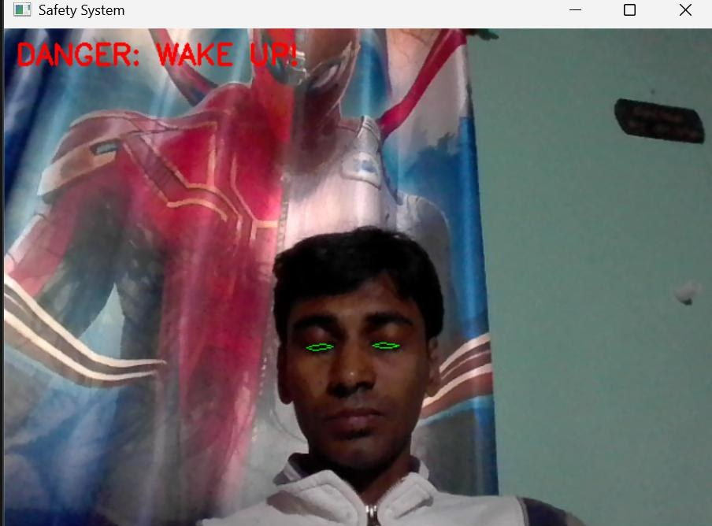
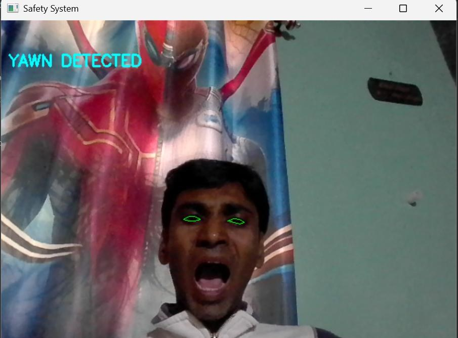

# Driver Drowsiness Detection

[](https://github.com/SayyanShaikh/drowsiness-detection/actions/workflows/tests.yml)

A real-time drowsiness detector that watches a person through a webcam and gives a spoken warning when they show signs of falling asleep.

| Eyes closed too long | Yawn |
|:---:|:---:|
|  |  |

It tracks 68 points on the face and checks these signs:

| Sign | How it is measured | What triggers it |
|------|--------------------|------------------|
| Closed eyes | **Eye Aspect Ratio (EAR)** – the height of the eye divided by its width | EAR stays below the person's own threshold for 20 frames in a row |
| Head nodding | **Head pitch** – how far the head tilts down, found with OpenCV `solvePnP` | Head tilted down more than 15° for 20 frames in a row |
| Yawning | **Mouth Aspect Ratio (MAR)** – mouth opening divided by its width | MAR above 0.6 for 15 frames in a row (shown on screen) |
| Face out of view | No face found after calibration – e.g. the head has dropped or turned away | 40 frames in a row (about 2–3 s) |

**Per-person calibration:** for the first 50 frames the person looks at the camera normally. The program records their open-eye EAR and sets the closed-eye threshold to 75% of that average, so it adapts to different eye shapes instead of using one fixed number.

When an alert fires, the screen shows **"DANGER: WAKE UP!"** (or **"FACE NOT VISIBLE!"**) and a voice says *"Attention. Please stay alert."* (at most once every 10 seconds). The voice runs in a background thread, so the video does not freeze while it speaks. If no speech engine is available, the program logs each alert and beeps instead.

If more than one face is in view (for example a passenger), only the largest face – the person closest to the camera – is tracked.

Built as the mini project of an AI/ML internship at Inventeron Technologies and Business Solutions LLP, Bengaluru (Sep–Dec 2025), during the M.Tech (CSE) programme at KLE Institute of Technology, Hubballi.

## Performance (on a laptop webcam)

| Measure | Result |
|---------|--------|
| Frame rate | 12–20 FPS |
| Alert delay, eyes closed / head nod | under 1 second |
| Alert delay, yawn | just over 1 second |
| CPU use | 30–70% |
| Memory | under 300 MB |

## Known limits

- Low light, strong backlight, sunglasses or a hand near the face make the landmarks unreliable.
- Talking or big facial expressions can look like a yawn for a moment. The 15-frame yawn rule removes most of these, but not all.
- Head-nod detection needs the camera roughly at eye level, for example above the dashboard.
- A single camera cannot tell drowsiness apart from, say, looking down at a phone.

## Next steps

- A small neural network for landmarks that copes better with poor light.
- Combine the camera with vehicle signals such as steering movement and lane keeping.
- Collect a labelled driving dataset and publish evaluation scripts.

## Setup

1. Install Python 3.10 or later (tested on 3.10 and 3.12).
2. Install the libraries:
   ```bash
   pip install -r requirements.txt
   ```
   On Windows, `dlib` needs CMake and the Visual Studio C++ build tools. If it fails, install those first, or use a pre-built dlib wheel that matches your Python version.
3. Download the face landmark model (about 100 MB, too large for GitHub):
   - http://dlib.net/files/shape_predictor_68_face_landmarks.dat.bz2
   - Extract it and put `shape_predictor_68_face_landmarks.dat` in this folder.

## Run

```bash
python detect_drowsiness.py                       # live webcam
python detect_drowsiness.py --video drive.mp4     # a recorded video instead
```

Press **q** to quit.

### Options

| Option | Default | Meaning |
|--------|---------|---------|
| `-p`, `--shape-predictor` | file in this folder | Path to the landmark model |
| `-c`, `--camera` | `0` | Webcam number |
| `-v`, `--video` | – | Analyse a video file instead of the webcam |
| `--no-window` | off | Do not open the preview window |
| `--no-voice` | off | Show and log alerts without speaking them |
| `--calibration-frames` | `50` | Frames used to learn the person's normal EAR |
| `--consec-frames` | `20` | Frames in a row needed before the alert |
| `--pitch-thresh` | `15` | Head-down angle (degrees) that counts as nodding |
| `--mouth-thresh` | `0.6` | MAR value that counts as a yawn |
| `--yawn-frames` | `15` | Frames in a row with the mouth that wide before a yawn is reported |
| `--lost-frames` | `40` | Frames in a row with no face (after calibration) before an alert |
| `--alarm-cooldown` | `10` | Seconds between spoken alerts |

## How the code is organised

| File | What it does |
|------|--------------|
| `detect_drowsiness.py` | Video input, drawing, voice alerts and the command line |
| `metrics.py` | EAR, MAR and head-pitch maths (NumPy and OpenCV only) |
| `alerts.py` | Calibration and the rules that decide when to alert |
| `tests/` | 43 tests that use synthetic faces, so no webcam or dlib is needed |

## Tests

```bash
pip install -r requirements-dev.txt
ruff check .
python -m pytest -q
```

The same checks run on GitHub for every push and pull request.

## Libraries used

dlib (face detection and landmarks), OpenCV (video, head pose), imutils, NumPy, pyttsx3 (offline text-to-speech).

## Note on the landmark model

The dlib 68-point model was trained on the iBUG 300-W dataset, whose licence does not allow commercial use. Check the licence before using this project commercially.

## Author

Sayyan Shaikh – [Homepage](https://sayyanshaikh.github.io/) · [GitHub](https://github.com/SayyanShaikh) · [ORCID](https://orcid.org/0009-0005-7107-8838)
